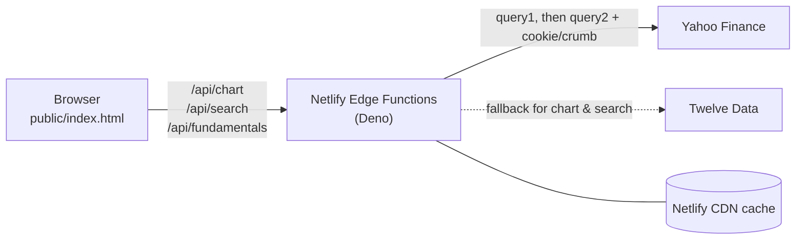

# StocksWatcher

A lightweight stock and index watchlist that runs as an installable web app (PWA). Search any ticker Yahoo Finance knows, follow it on an interactive chart, see prices in the original currency, EUR or USD, track your own position and profit/loss, and get a quick valuation read on a company.

No framework, no build step, no account: the whole interface is a single HTML file, and the server side is three small Netlify Edge Functions.

## Features

- **Watchlist** – add stocks, ETFs, indices and currency pairs by name or ticker (e.g. `Nvidia`, `ENEL.MI`, `^IXIC`, `EURUSD=X`). Cards can be reordered by drag and drop or with the arrow keys, and collapsed on mobile.
- **Charts** – 1 day, 1 week, 1 month and 1 year ranges, with axes, min/max stats, a scrubbing tooltip, and zoom and pan in the detail view.
- **Currency conversion** – show every price in its original currency, in EUR or in USD. London (pence), Johannesburg and Tel Aviv sub-unit quotes are normalised automatically.
- **Your position** – enter quantity and average purchase price per ticker (in the quote currency, EUR or USD) to see profit/loss on the card and in the detail view. When the purchase currency differs from the quote currency, the result includes the exchange-rate effect.
- **Valuation (optional)** – the **P/E** button in the header turns on a panel with key ratios (P/E, forward P/E, PEG, price/book, EV/EBITDA, dividend yield, ROE, debt/equity) and three fair-value estimates compared with the current price:
  - **Graham number**: √(22.5 × EPS × book value per share)
  - **Two-stage discounted earnings**: EPS grown for 5 years at the expected rate (capped at 15%), then 2.5% perpetual growth, discounted at 9%
  - **Analyst consensus**: mean target price and number of analysts

  These are standard textbook formulas meant as a starting point for analysis, not investment advice.
- **Italian and English** interface, with numbers and dates formatted for the chosen language.
- **Light, dark or automatic theme**, WCAG AA contrast, full keyboard and screen-reader support.

Everything you enter (watchlist, positions, preferences) is stored only in your browser's `localStorage`. Nothing is sent to a server apart from the ticker symbols needed to fetch market data.

## How it works



### Front end

[`public/index.html`](public/index.html) contains all the HTML, CSS and JavaScript. It calls the app's own `/api/*` endpoints, draws charts as inline SVG, and converts currencies by fetching the relevant FX pair (e.g. `USDEUR=X`) through the same chart endpoint. Responses are cached in memory for a minute (FX rates for five).

### API (Netlify Edge Functions)

The browser can't call Yahoo Finance directly because of CORS, so three edge functions act as a thin proxy and reshape the responses:

| Endpoint | File | Returns |
|---|---|---|
| `GET /api/chart?symbol=GOOGL&range=1d\|1w\|1m\|1y` | [`chart.js`](netlify/edge-functions/chart.js) | Name, currency, exchange, last price, previous close and `[timestamp, close]` points |
| `GET /api/search?q=nvidia` | [`search.js`](netlify/edge-functions/search.js) | Up to 10 matching tickers |
| `GET /api/fundamentals?symbol=AAPL` | [`fundamentals.js`](netlify/edge-functions/fundamentals.js) | Ratios and valuation estimates (computed in [`valuation.mjs`](netlify/lib/valuation.mjs)) |

**Why Edge Functions:** Yahoo answers `429 Too Many Requests` to regular Netlify Functions (which run on AWS), but not to Edge Functions (Deno), so all data calls run at the edge.

**Getting past Yahoo's limits** ([`yahoo.mjs`](netlify/lib/yahoo.mjs)): each request first goes to `query1.finance.yahoo.com`. On a 401 or 429 it fetches a session cookie from `fc.yahoo.com`, exchanges it for a crumb, and retries on `query2` with both. The session is reused while the function stays warm and refreshed when it expires.

**Fallback** ([`twelvedata.mjs`](netlify/lib/twelvedata.mjs)): if Yahoo still fails, chart and search fall back to [Twelve Data](https://twelvedata.com). The free plan only covers US stocks and forex (8 requests per minute), so symbols like `SWDA.MI` or `^GSPC` have no fallback. Its responses are converted to the same shape as Yahoo's, so the front end doesn't know the difference.

**Caching:** responses are cached on Netlify's CDN (chart 5 minutes, search 1 hour, fundamentals 6 hours) to keep upstream calls down. `Netlify-Vary` keys the cache on the query parameters; without it the CDN could serve one ticker's data for another.

## Running locally

Requires Node.js and the Netlify CLI.

```bash
npm install -g netlify-cli
```

```bash
netlify dev
```

Then open http://localhost:8888.

The Twelve Data fallback is optional. To enable it, get a free API key and put it in a `.env` file at the project root (already git-ignored):

```
TWELVEDATA_API_KEY=your_key_here
```

## Deploying

Connect the repository to Netlify. No build command is needed; `netlify.toml` publishes the `public` folder and the edge functions are picked up automatically. To use the fallback, set `TWELVEDATA_API_KEY` under *Site configuration → Environment variables*.

## Tests

The data-shaping and valuation logic has unit tests using Node's built-in test runner:

```bash
node --test netlify/lib/*.test.mjs
```

## Project structure

```
public/
  index.html               the whole app: UI, charts, i18n, state
  manifest.webmanifest     PWA manifest
  icon-*.png               app icons
netlify/
  edge-functions/          /api/chart, /api/search, /api/fundamentals
  lib/
    yahoo.mjs              Yahoo fetch with cookie + crumb retry
    twelvedata.mjs         Twelve Data fallback and response mapping
    valuation.mjs          ratios, Graham number, discounted earnings
    *.test.mjs             unit tests
netlify.toml               publish dir and manifest content type
```

## Disclaimer

Market data comes from Yahoo Finance's unofficial endpoints and from Twelve Data, may be delayed or wrong, and can stop working if those services change. Valuation figures are mechanical estimates based on the assumptions above. Nothing in this app is financial advice.

## License

[MIT](LICENSE)
